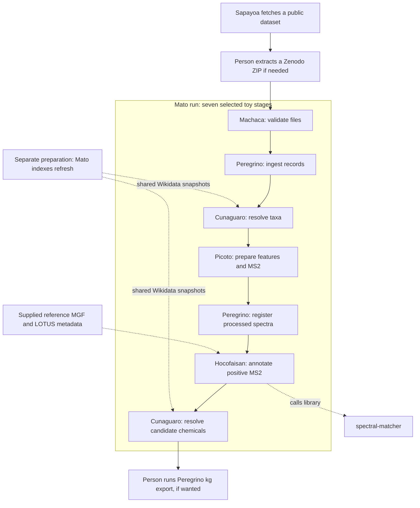

# Isla Gabriola flock

A mass-spectrometry dataset describes samples and the signals measured from them. The **flock** is seven separately versioned programs, or *species*, that keep those signals connected to their source files while looking for possible chemical matches. A match is a lead to investigate, **not proof** that a chemical was present. A searchable knowledge graph can be exported from the recorded evidence.

## Who does what

- **[Sapayoa](https://github.com/oolonek/sapayoa)** downloads public datasets by DOI and records what it fetched. A downloaded Zenodo ZIP still needs to be extracted by the person running the job.
- **[Machaca](https://github.com/oolonek/machaca)** checks that raw measurement files named in sample metadata are actually present.
- **[Peregrino](https://github.com/oolonek/peregrino)** keeps sample records and processed-file references in a job's SQLite database, registers Picoto's output, and can separately export the evidence as a knowledge graph.
- **[Cunaguaro](https://github.com/oolonek/cunaguaro)** looks up organism names and, later, candidate chemical identifiers against prepared Wikidata snapshots; it records missing and ambiguous matches instead of guessing.
- **[Picoto](https://github.com/oolonek/picoto)** finds features in raw measurements and prepares MS2 spectra for comparison. It does not identify chemicals.
- **[Hocofaisan](https://github.com/oolonek/hocofaisan)** compares registered positive-mode MS2 spectra with a supplied reference library, uses LOTUS metadata to help rank the candidates, and records the results. It calls [spectral-matcher](https://github.com/earth-metabolome-initiative/spectral-matcher) as a library; that library is **not an eighth flock species**.
- **[Mato](https://github.com/oolonek/mato)** runs the stages you select in a job configuration, in order. It does not download datasets, extract archives, refresh lookup snapshots during a job, or export the graph.

## What actually runs

This is the **checked-in toy job's selected order**, not an automatic workflow for every dataset. The ordinary MassIVE example selects **annotation only**; its `--topN` example selects all seven stages. Each job needs paths and inputs configured on your own machine.

The [data-and-results picture](data-and-results.svg) shows where inputs and outputs live; it is **not** another sequence of commands. The database and Picoto outputs belong to a configured job; the lookup snapshots can be shared across jobs. A scored hit remains a candidate even when an external identifier is found. SIRIUS and negative-mode annotation are **not** part of this run.

## Start here

1. Read a species' linked README above for its purpose and picture; its technical guide has its commands and limits.
2. For a complete example, follow [Mato's Zenodo-to-graph walkthrough](https://github.com/oolonek/mato/blob/master/TECHNICAL.md#example-download-the-zenodo-toy-dataset-and-export-a-kg). It includes a separate reference library download and Wikidata snapshot preparation, so check its disk and network prerequisites before starting.
3. If your dataset is already available, configure only the stages you need in a local Mato job; graph export remains a separate Peregrino command.

This repository contains only the public overview. Source datasets, locally configured jobs, and workstation notes stay outside it. The overview text and diagram are available under the [MIT license](LICENSE).

*Naming note: For new species names, we take inspiration from [colonizer](https://crates.io/crates/colonizer)'s `inspire` mode, which suggests names from the Catalogue of Life, rather than inventing each crate name ourselves.*
